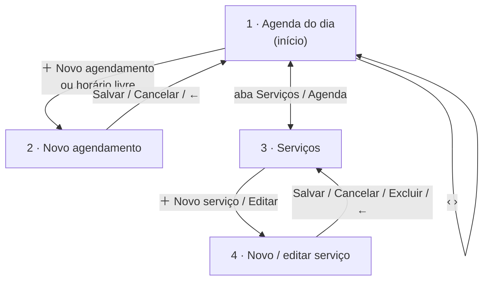
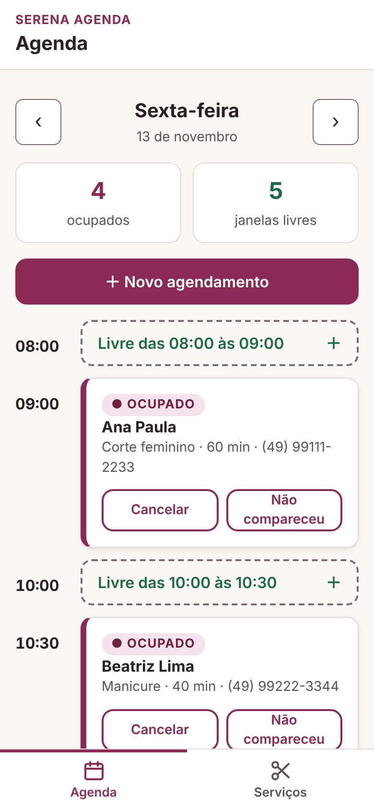
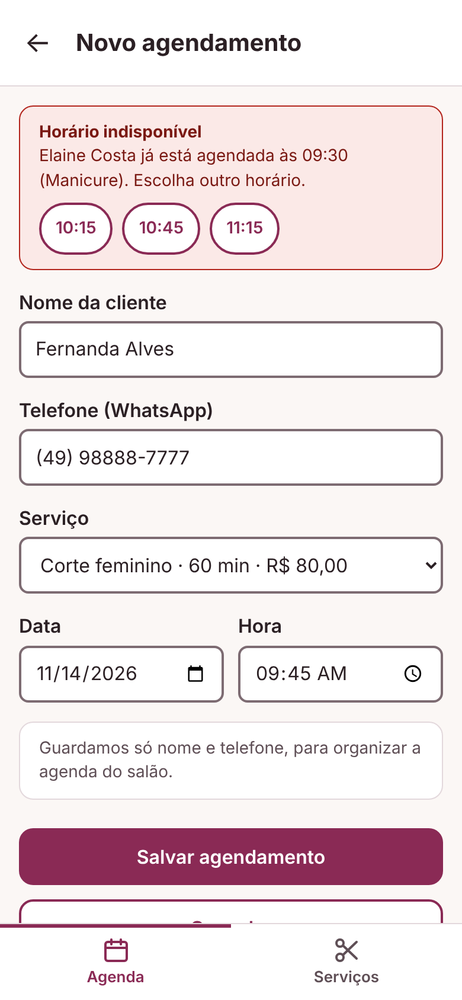
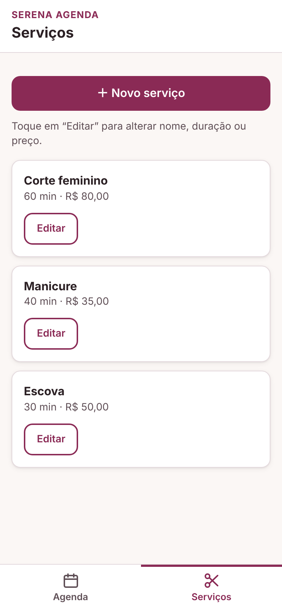
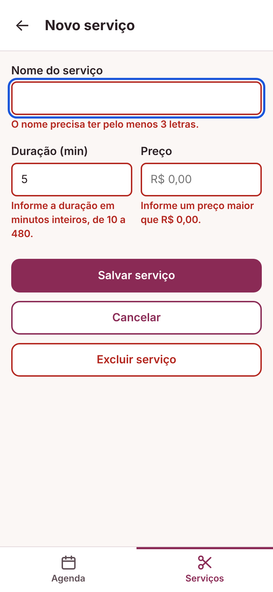

# Serena Agenda · UX/UI e Protótipo (Aula 02)

> Exercício 02: prototipar as 4 telas do MVP a partir do [documento de requisitos](../README.md).
> Protótipo navegável em HTML: abra [`prototipo/index.html`](../prototipo/index.html) no navegador (não precisa instalar nada).
> Conteúdo gerado com apoio de IA e **validado com testes no navegador** (ver seção 6). Os dados do protótipo ficam só no navegador (`localStorage`); no MVP real, o RF09 pede banco remoto.

## Sumário

1. [Mapa de telas](#1--mapa-de-telas)
2. [Wireframes lo-fi](#2--wireframes-lo-fi)
3. [Tokens visuais](#3--tokens-visuais)
4. [Telas hi-fi](#4--telas-hi-fi)
5. [Navegação e rastreabilidade com os requisitos](#5--navegação-e-rastreabilidade)
6. [Teste heurístico](#6--teste-heurístico)
7. [Perguntas de fechamento e autoavaliação](#7--perguntas-de-fechamento-e-autoavaliação)
8. [Referências](#referências)
9. [Apêndice: prompts CTQ](#apêndice--prompts-ctq-por-tela)

---

## 1 · Mapa de telas

**Jornada da persona primária (Mariana):** durante um atendimento, abre o celular → vê a agenda do dia → toca em um horário livre ou em "Novo agendamento" → preenche → o sistema avisa se há conflito → salva e volta à agenda. De vez em quando, ajusta os serviços (preço, duração).

**Pontos de fricção que o desenho precisa resolver** (vindos da entrevista simulada):

| Fricção | Resposta de design |
|---|---|
| Registrar leva mais de 30 s e a mão está ocupada | Poucos campos, alvos de toque grandes, horário livre pré-preenche data e hora |
| Conflito de horário descoberto tarde | Aviso no momento de salvar, com 3 horários alternativos |
| Esquece preço e duração dos serviços | Lista de serviços e preço/duração dentro do seletor de serviço |
| Medo de perder dados | Confirmação antes de cancelar ou excluir; mensagens de sucesso visíveis |

**As 4 telas essenciais:**

| # | Tela | Arquivo | Requisitos |
|---|---|---|---|
| 1 | Agenda do dia | `agenda.html` | RF06, RF07, US-04, US-05 |
| 2 | Novo agendamento | `novo-agendamento.html` | RF04, RF05, RF08, US-02, US-03 |
| 3 | Serviços | `servicos.html` | RF02, US-01 |
| 4 | Novo / editar serviço | `novo-servico.html` | RF01, RF03, RF08, US-01 |

**Árvore de navegação** (profundidade máxima: 2, dentro do limite de 3):



Sem dead-ends: toda tela tem caminho de volta (botão ←, "Cancelar" e a barra inferior). Verificado por teste (seção 6.1).

---

## 2 · Wireframes lo-fi

Rascunhos focados em fluxo e hierarquia, sem visual. Em cada tela há **um único elemento dominante** (marcado com ★).

**Tela 1 · Agenda do dia**
```
┌──────────────────────────────┐
│ SERENA AGENDA                │
│ Agenda                       │
├──────────────────────────────┤
│ [‹]    Sexta-feira      [›]  │
│         13 de novembro       │
│ ┌────────────┐ ┌───────────┐ │
│ │  4 ocupados│ │5 janelas  │ │
│ │            │ │  livres   │ │
│ └────────────┘ └───────────┘ │
│ ╔══════════════════════════╗ │
│ ║ ★ ＋ Novo agendamento    ║ │
│ ╚══════════════════════════╝ │
│ 08:00 ┌┄┄┄┄┄┄┄┄┄┄┄┄┄┄┄┄┄┄┄┐  │
│       ┆ Livre 08:00–09:00 ＋┆ │
│       └┄┄┄┄┄┄┄┄┄┄┄┄┄┄┄┄┄┄┄┘  │
│ 09:00 ┌────────────────────┐ │
│       │ ● OCUPADO          │ │
│       │ Ana Paula          │ │
│       │ Corte · 60 min     │ │
│       │ [Cancelar][Não vei]│ │
│       └────────────────────┘ │
├──────────────────────────────┤
│   [ Agenda ]   [ Serviços ]  │
└──────────────────────────────┘
```

**Tela 2 · Novo agendamento**
```
┌──────────────────────────────┐
│ [←] Novo agendamento         │
├──────────────────────────────┤
│ ┌ aviso de conflito ───────┐ │  ← só aparece se houver conflito
│ │ Horário indisponível     │ │
│ │ (10:15) (10:45) (11:15)  │ │
│ └──────────────────────────┘ │
│ Nome da cliente              │
│ [______________________]     │
│ Telefone (WhatsApp)          │
│ [______________________]     │
│ Serviço                      │
│ [Corte · 60 min · R$ 80  ▾]  │
│ Data          Hora           │
│ [__/__/____]  [__:__]        │
│ ℹ Guardamos só nome e tel.   │
│ ╔══════════════════════════╗ │
│ ║ ★ Salvar agendamento     ║ │
│ ╚══════════════════════════╝ │
│ [        Cancelar          ] │
├──────────────────────────────┤
│   [ Agenda ]   [ Serviços ]  │
└──────────────────────────────┘
```

**Tela 3 · Serviços**
```
┌──────────────────────────────┐
│ SERENA AGENDA                │
│ Serviços                     │
├──────────────────────────────┤
│ ╔══════════════════════════╗ │
│ ║ ★ ＋ Novo serviço        ║ │
│ ╚══════════════════════════╝ │
│ ┌──────────────────────────┐ │
│ │ Corte feminino           │ │
│ │ 60 min · R$ 80,00        │ │
│ │ [Editar]                 │ │
│ └──────────────────────────┘ │
│ ┌──────────────────────────┐ │
│ │ Manicure ...             │ │
│ └──────────────────────────┘ │
├──────────────────────────────┤
│   [ Agenda ]   [ Serviços ]  │
└──────────────────────────────┘
```

**Tela 4 · Novo / editar serviço**
```
┌──────────────────────────────┐
│ [←] Novo serviço             │
├──────────────────────────────┤
│ Nome do serviço              │
│ [______________________]     │
│ Duração (min)    Preço       │
│ [______]         [R$ 0,00]   │
│ ╔══════════════════════════╗ │
│ ║ ★ Salvar serviço         ║ │
│ ╚══════════════════════════╝ │
│ [        Cancelar          ] │
│ [  Excluir serviço ]         │  ← só ao editar
├──────────────────────────────┤
│   [ Agenda ]   [ Serviços ]  │
└──────────────────────────────┘
```

---

## 3 · Tokens visuais

Escolhi uma paleta própria (ameixa + tons quentes), coerente com um salão de beleza. Os tokens estão em [`prototipo/css/tokens.css`](../prototipo/css/tokens.css) e **todas as telas usam só esses valores**.

### 3.1 Cores e contraste (calculado, WCAG 1.4.3)

| Token | Hex | Uso | Par testado | Contraste |
|---|---|---|---|---|
| `--cor-primaria` | `#8A2A55` | Ação principal, destaque | branco sobre primária | **8,26:1** ✅ |
| `--cor-texto` | `#2B2024` | Texto | sobre `#FBF7F5` | **14,78:1** ✅ |
| `--cor-texto-suave` | `#5F4F56` | Texto secundário | sobre branco | **7,67:1** ✅ |
| `--cor-sucesso` | `#1B6B47` | "Livre", sucesso | sobre branco | **6,48:1** ✅ |
| `--cor-perigo` | `#B3261E` | Erros, ações destrutivas | sobre branco | **6,54:1** ✅ |
| `--cor-ocupado-texto` / fundo | `#6E1F42` / `#F5E3EB` | Chip "Ocupado" | texto sobre fundo | **8,81:1** ✅ |
| `--cor-aviso` / fundo | `#7A4B00` / `#FFF1D6` | Chip "Não compareceu" | texto sobre fundo | **6,64:1** ✅ |
| `--cor-borda-campo` | `#7D6B72` | Borda de campos (componente de UI) | sobre branco | **4,98:1** ✅ (mínimo 3:1) |
| `--cor-foco` | `#1A56DB` | Anel de foco (3 px) | contra fundos claros | visível em todos os controles |

Regra: **nunca usar só cor para informar**. Status usa cor, ícone e texto ("● Ocupado", "✕ Cancelado", "! Não compareceu"); erros trazem texto, não só borda vermelha.

### 3.2 Tipografia

| Token | Valor | Uso |
|---|---|---|
| `--fonte` | `system-ui, -apple-system, "Segoe UI", Roboto, …` | Sem fonte externa: carrega rápido (RNF02) |
| `--texto-md` | 16 px | Texto base (evita zoom automático em campos no iOS) |
| `--texto-lg` / `--texto-xl` | 20 px / 24 px | Título de tela / números do resumo |
| `--texto-sm` / `--texto-xs` | 14 px / 13 px | Apoio e rótulos |
| Pesos | 400 / 600 / 700 | Corpo / ênfase / títulos e botões |

### 3.3 Espaçamento e forma

Escala de 4 px: `4, 8, 12, 16, 24, 32`. Raio `12 px` (cartões e botões) e `8 px` (campos). Alvo de toque mínimo `48 px` (`--alvo-toque`), acima dos 24 px do WCAG 2.5.8 AA e dos 44 px recomendados.

---

## 4 · Telas hi-fi

HTML, CSS e um pouco de JavaScript simples, sem frameworks. As capturas abaixo são do protótipo real (390 px de largura).

| 1 · Agenda do dia | 2 · Novo agendamento (conflito) | 3 · Serviços | 4 · Serviço (com erros) |
|---|---|---|---|
|  |  |  |  |

**Estados também prototipados:** [erros de validação](img/hifi-2b-novo-agendamento-erros.png), [agenda após salvar](img/hifi-1b-agenda-apos-salvar.png), [confirmar cancelamento](img/hifi-1c-confirmar-cancelamento.png), [serviços após salvar](img/hifi-3b-servicos-apos-salvar.png) e [editar serviço](img/hifi-4b-editar-servico.png).

**O que funciona de verdade no protótipo:** criar/editar/excluir serviços; criar agendamentos; **detecção de conflito considerando a duração** (agendamentos consecutivos são permitidos); sugestão de 3 horários livres; cancelar (com confirmação) e marcar "não compareceu"; navegar entre dias; validações com mensagens em português.

**Como rodar:** baixe o repositório e abra `prototipo/index.html`. Para publicar com link, ative o GitHub Pages (Settings → Pages → branch `main`, pasta `/ (root)`) e acesse `.../prototipo/`.

---

## 5 · Navegação e rastreabilidade

| Requisito | Onde aparece no protótipo |
|---|---|
| RF01 Cadastrar serviço | Tela 4 |
| RF02 Listar serviços | Tela 3 e seletor da tela 2 |
| RF03 Editar/excluir serviço | Tela 4 (modo editar, com confirmação de exclusão) |
| RF04 Cadastrar agendamento | Tela 2 |
| RF05 Impedir conflito | Tela 2 (alerta com alternativas) |
| RF06 Consultar por data | Tela 1 (setas de dia, horários livres e ocupados) |
| RF07 Cancelar / no-show | Tela 1 (botões no cartão) |
| RF08 Validar formulários | Telas 2 e 4 (mensagens junto ao campo) |
| RF09 Persistir | Simulado com `localStorage` (banco remoto fica para a fase de código) |
| RNF01 Mobile-first ≥ 320 px | Testado em 320 e 360 px, sem rolagem horizontal |
| RNF03 Acessibilidade | Seção 6.3 |
| RNF06 Aviso de privacidade e `noindex` | Tela 2 (aviso) e `<meta name="robots" content="noindex">` em todas |

---

## 6 · Teste heurístico

**Método.** Avaliação heurística com 5 das 10 heurísticas de Nielsen (H1, H3, H4, H5, H9), aplicadas a cada tela, mais verificação de acessibilidade (POUR). Cada achado vem de teste real no navegador (Chromium, 390 px e 320 px) e **não de opinião**. Severidade na escala de Nielsen: 0 = sem problema, 1 = cosmético, 2 = menor, 3 = grave, 4 = catastrófico.

> Se o professor definir outras 5 heurísticas, a tabela se adapta, pois os testes cobrem a maior parte das 10.

### 6.1 Testes executados (evidências)

| Teste | Resultado |
|---|---|
| Erros de console em todos os fluxos | **0 erros** |
| Fluxo completo: agenda → novo agendamento → conflito → sugestão → salvar → agenda | ✅ |
| Fluxo serviços: criar → editar → excluir (com confirmação) | ✅ |
| Dead-ends: cada tela tem pelo menos 3 rotas de saída | ✅ (←, Cancelar e barra inferior) |
| Rolagem horizontal em 320 px e 360 px | ✅ nenhuma (depois da correção #2) |
| Alvos de toque < 44 px | ✅ nenhum (com viewport de 320 px) |
| Foco por teclado visível (anel de 3 px) | ✅ em todos os botões, links e campos. Exceção: partes internas do seletor nativo de data e hora, controladas pelo navegador |
| Ordem de Tab | ✅ segue a ordem visual; a 1ª parada é o link "Ir para o conteúdo" |
| `Esc` fecha o diálogo de confirmação e o foco inicial é "Voltar" (opção segura) | ✅ |

### 6.2 Resultado por tela

#### Tela 1 · Agenda do dia

| Heurística | Evidência | Sev. | Ação |
|---|---|---|---|
| **H1 Visibilidade do status** | Cada cartão tem chip "Ocupado/Cancelado/Não compareceu"; mensagens "Agendamento salvo/cancelado" aparecem em área `role="status"` | 0 | — |
| **H3 Controle e liberdade** | Cancelar pede confirmação e pode ser desfeito voltando. **"Não compareceu" não tem desfazer.** | 2 | Aberto: incluir "Desfazer" na próxima versão |
| **H4 Consistência** | Mesmo padrão de cartão, botões e barra inferior das demais telas | 0 | — |
| **H5 Prevenção de erros** | Cancelamento exige confirmação; o botão destrutivo não é o foco inicial | 0 | — |
| **H9 Recuperação de erros** | Dia sem agendamentos mostra estado vazio explicativo | 0 | — |
| **Hierarquia (2 s)** | O elemento que fala mais alto é o botão cheio "＋ Novo agendamento" | 0 | — |

*Problemas achados e corrigidos durante o teste:* (a) o botão flutuante **cobria** os botões "Cancelar" dos cartões (sev. 3), então foi substituído por botão fixo no topo da lista; (b) o dia aparecia como "Sexta-Feira" (sev. 1), corrigido.

#### Tela 2 · Novo agendamento

| Heurística | Evidência | Sev. | Ação |
|---|---|---|---|
| **H1** | Ao salvar, volta à agenda com "Agendamento salvo" | 0 | — |
| **H3** | ←, "Cancelar" e barra inferior saem sem perder nada | 0 | — |
| **H4** | Rótulos acima dos campos, botão primário cheio e secundário vazado, como nas demais telas | 0 | — |
| **H5** | Máscara de telefone `(49) 98888-7777`; data mínima = hoje; horário passado e fora do expediente são bloqueados; conflito detectado considerando duração | 1 | O expediente (08–20h) é suposição de negócio |
| **H9** | Erro junto ao campo, com texto e foco no 1º campo inválido; conflito aponta quem ocupa o horário e **oferece 3 alternativas** clicáveis | 0 | — |
| **Hierarquia (2 s)** | "Salvar agendamento" (botão cheio) | 0 | — |

*Problema achado e corrigido:* em 320 px a tela rolava na horizontal por causa dos campos de data e hora (sev. 2). Corrigido com `minmax(0, 1fr)`.
*Residual (sev. 1):* o seletor de data e hora é o nativo do navegador e varia entre aparelhos (ex.: "AM/PM" em alguns).

#### Tela 3 · Serviços

| Heurística | Evidência | Sev. | Ação |
|---|---|---|---|
| **H1** | "Serviço salvo" e "Serviço excluído" confirmam o resultado | 0 | — |
| **H3** | Saída pela barra inferior; edição é reversível | 0 | — |
| **H4** | Cartão e botão "Editar" seguem o mesmo padrão da agenda | 0 | — |
| **H5** | Exclusão é feita só dentro da edição (não na lista), reduzindo toque acidental | 0 | — |
| **H9** | Lista vazia explica o que fazer | 0 | — |
| **Hierarquia (2 s)** | "＋ Novo serviço" | 0 | — |

#### Tela 4 · Novo / editar serviço

| Heurística | Evidência | Sev. | Ação |
|---|---|---|---|
| **H1** | Salvar leva à lista com confirmação | 0 | — |
| **H3** | Cancelar e ← voltam sem salvar | 0 | — |
| **H4** | Mesmos campos, rótulos e botões da tela 2 | 0 | — |
| **H5** | Preço com máscara automática (`R$ 120,00`); exclusão pede confirmação e **avisa se há agendamentos ativos** com o serviço | 2 | **Aberto:** excluir um serviço em uso deixa o agendamento com "Serviço removido". Na versão com banco, bloquear ou arquivar. |
| **H9** | Mensagens específicas: "Informe a duração em minutos inteiros, de 10 a 480." | 0 | — |
| **Hierarquia (2 s)** | "Salvar serviço" | 0 | — |

### 6.3 Acessibilidade básica (POUR)

| Princípio | Verificação | Resultado |
|---|---|---|
| **P**erceptível | Contraste ≥ 4,5:1 em todo texto (seção 3.1); status com texto + ícone, não só cor; `lang="pt-BR"` | ✅ |
| **O**perável | Tudo acessível por Tab/Enter/Esc; foco de 3 px; link "Ir para o conteúdo"; alvos ≥ 48 px | ✅ |
| **C** (Compreensível) | Rótulos visíveis em todos os campos; erros em linguagem simples; navegação idêntica em todas as telas | ✅ |
| **R**obusto | HTML semântico (`main`, `nav`, `header`, `dialog`), `aria-current`, `aria-invalid`, `aria-label` descritivo nos botões repetidos | ✅ |
| **Limite** | Não foi testado com leitor de tela real (NVDA/VoiceOver). Fica como pendência. | ⏳ |

---

## 7 · Perguntas de fechamento e autoavaliação

**1. Hierarquia.** Em cada tela há um único elemento dominante (o botão cheio de ação principal). O teste dos 2 segundos passa nas 4 telas.

**2. Acessibilidade.** Sim: o teste percorreu todas as telas só com Tab, Enter e Esc, e o foco tem anel visível de 3 px em todos os controles (exceto partes internas do campo nativo de data e hora).

**3. Validação humana.** Pontos que **você deve entender antes de apresentar** (o código foi gerado por IA, e usar sem entender é débito técnico):

| Trecho | O que faz | Como validei |
|---|---|---|
| `grid-template-columns: minmax(0, 1fr) minmax(0, 1fr)` | Impede que campos de data estourem a largura em telas estreitas | Reproduzi o overflow em 320 px antes e depois |
| `:focus-visible` | Mostra o anel de foco só em navegação por teclado | Testei a ordem de Tab e a propriedade `outline` de cada controle |
| `<dialog>` e `showModal()` | Caixa de confirmação nativa, com foco preso e `Esc` | Testei `Esc` e o foco inicial |
| `textContent` em vez de `innerHTML` | Evita injeção de HTML pelo nome da cliente | Revisão do código (nenhum dado do usuário entra como HTML) |
| `localStorage` | Guarda os dados só no navegador, só para demonstrar | Conferi que o protótipo funciona sem ele (cai em memória) |

**Autoavaliação**
- [x] Distingo UX de UI: UX é a jornada e a lógica (seções 1 e 5); UI é a camada visual (seções 3 e 4).
- [x] Mapeei a jornada com pontos de fricção (seção 1).
- [x] Mapa de telas com profundidade ≤ 3 (profundidade 2).
- [x] Tokens definidos: cores, tipografia e espaçamento (seção 3).
- [x] 4 telas em alta fidelidade prontas e navegáveis (seção 4).
- [x] Teste heurístico aplicado em cada tela (seção 6).

---

## Referências

1. Nielsen, J. *10 Usability Heuristics for User Interface Design*. Nielsen Norman Group. https://www.nngroup.com/articles/ten-usability-heuristics/ (lista conferida em https://principles.design/examples/10-usability-heuristics-for-user-interface-design)
2. W3C. *Understanding SC 1.4.3: Contrast (Minimum)*, WCAG 2.2. https://w3c.github.io/wcag/understanding/contrast-minimum.html
3. W3C. *Understanding SC 2.5.8: Target Size (Minimum)*, WCAG 2.2. https://www.w3.org/WAI/WCAG22/Understanding/target-size-minimum.html
4. Documento de requisitos da Aula 1 ([README.md](../README.md)).
5. Material da Aula 02 · UX → UI → Protótipo (entregáveis, critérios de avaliação e perguntas de fechamento).

> A escala de severidade 0–4 é a de Nielsen e foi usada de memória, sem consulta à página do NN/g durante a elaboração. Vale conferir a fonte.

---

## Apêndice · Prompts CTQ por tela

Cada tela foi gerada a partir de um prompt estruturado (Contexto, Tarefa, Quem). Modelo, com a tela 2 como exemplo; para as demais troque a tarefa:

```
# CONTEXTO
App web "Serena Agenda" para um salão de beleza em Lages/SC, mobile-first (≥ 320 px), sem login.
Persona primária: Mariana, cabeleireira, usa o celular com as mãos ocupadas; registrar deve levar < 30 s.
Requisitos: RF04, RF05, RF08; ACs da US-02 e US-03 (documento de requisitos).
Tokens: paleta ameixa (#8A2A55), fundo #FBF7F5, fonte system-ui, espaçamento base 4 px, alvo de toque 48 px.

# TAREFA
Gere em HTML + CSS a tela "Novo agendamento": campos nome, telefone com máscara, serviço, data e hora;
aviso de privacidade (LGPD); botão primário "Salvar" e secundário "Cancelar".
Se houver conflito, mostre alerta com o nome de quem ocupa o horário e 3 horários alternativos.
Um único elemento dominante. Foco visível, rótulos sempre visíveis, erros em texto junto ao campo.

# QUEM
Você é um designer de interfaces sênior, especialista em acessibilidade (WCAG 2.2 AA) e formulários mobile.
```

Variações de tarefa: **Tela 1** (agenda do dia com janelas livres, ocupados, cancelar e "não compareceu"), **Tela 3** (lista de serviços com estado vazio) e **Tela 4** (formulário de serviço com máscara de preço, validação e exclusão com confirmação).

> A revisão humana é parte do processo: o protótipo gerado foi testado no navegador, e os 3 defeitos encontrados (botão flutuante cobrindo botões, overflow em 320 px e capitalização da data) foram corrigidos e retestados.
